::: {custom-style="Title"}
МИНИСТЕРСТВО НАУКИ И ВЫСШЕГО ОБРАЗОВАНИЯ РФ

ФЕДЕРАЛЬНОЕ ГОСУДАРСТВЕННОЕ БЮДЖЕТНОЕ ОБРАЗОВАТЕЛЬНОЕ УЧРЕЖДЕНИЕ ВЫСШЕГО ОБРАЗОВАНИЯ

«ЛИПЕЦКИЙ ГОСУДАРСТВЕННЫЙ ТЕХНИЧЕСКИЙ УНИВЕРСИТЕТ»
:::

Институт Компьютерных наук

Кафедра Автоматизированных систем управления

::: {custom-style="Subtitle"}
ЛАБОРАТОРНАЯ РАБОТА №3

По дисциплине: «Системы искусственного интеллекта»

На тему: «Нечёткие системы логического вывода»

ПОЯСНИТЕЛЬНАЯ ЗАПИСКА
:::

Студент ПИ-23-1 \_\_\_\_\_\_\_\_\_\_\_\_\_\_\_ Петров М. В.

Руководитель \_\_\_\_\_\_\_\_\_\_\_\_\_\_\_ Первушин О. С.

::: {custom-style="Subtitle"}
Липецк 2026
:::

```{=openxml}
<w:p><w:r><w:br w:type="page"/></w:r></w:p>
```

# 1. Цель работы

Разработать программное обеспечение для обработки нечётких систем логического вывода с одной и несколькими входными переменными, в котором база правил и нечёткие множества хранятся в отдельном текстовом файле, а пользователь может выбирать импликацию, оператор агрегации и механизм вывода с max-min композицией. На основе предметной области лабораторных работ № 1, 2 построить систему с одним входом не менее чем из 7 правил и найти её выход тремя механизмами вывода (двумя композиционными и одним с использованием уровней истинности предпосылок), затем систему с тремя входами не менее чем из 7 правил с выводом по уровням истинности, используя дефаззификацию методом центра тяжести, и сравнить результаты, полученные при разных импликациях.

# 2. Предметная область и постановка задачи

## 2.1. Предметная область

**Тема:** оценка приоритета доработки сценария активации пользователей цифрового продукта.

Предметная область продолжает лабораторные работы № 1, 2, в которых экспертная система анализировала воронку активации: последовательность шагов от регистрации до целевого действия. В базе правил ЛР 2 числовые показатели воронки описывались объектами с двумя-тремя значениями, разделёнными жёстким порогом: «доля_достижения_активации = в_пределах_цели / ниже_цели», «доля_выбывших_по_неактивности = низкая (до 20%) / высокая (свыше 40%)», «удержание_после_активации = сохраняется / снижается». При таком разбиении доля выбывших 20% относится к значению «низкая», а значения от 21 до 40% не относятся ни к одному из значений, и правила, в условии которых стоит этот объект, для них не срабатывают.

В настоящей работе те же показатели описаны лингвистическими переменными с нечёткими термами: значение принадлежит нескольким соседним термам с разными степенями, поэтому на один вход срабатывают сразу несколько правил, а результат — приоритет доработки сценария по шкале от 0 до 6 баллов — меняется плавно.

## 2.2. Лингвистические переменные

Универсумы заданы дискретными сетками. Термы заданы параметрами треугольных (tri [a; b; c] — левая граница, вершина, правая граница) и трапециевидных (trap [a; b; c; d] — плато на [b; c]) функций принадлежности; значения в узлах сетки программа вычисляет сама.

Table: Таблица 1 — Лингвистические переменные

| Переменная | Назначение | Универсум | Термы |
|------------------------------|------------------|---------------|---------|
| доля_достижения_активации | вход системы с одним входом | 0..120 % от цели, шаг 10 | 7 термов tri |
| приоритет_доработки | выход обеих систем | 0..6 баллов, шаг 0,5 | 7 термов tri |
| доля_достижения_активации_3 | вход x1 системы с тремя входами | 0..120 % от цели, шаг 10 | 3 терма |
| доля_выбывших_по_неактивности | вход x2 | 0..100 %, шаг 5 | 3 терма |
| удержание_после_активации | вход x3 | 0..100 %, шаг 5 | 3 терма |

Table: Таблица 2 — Термы переменных системы с одним входом

| Терм входа | Параметры | Терм выхода | Параметры |
|------------------|------------------------|-------------|------------------|
| критически_низкая | tri [−20; 0; 20] | не_требуется | tri [−1; 0; 1] |
| очень_низкая | tri [0; 20; 40] | минимальный | tri [0; 1; 2] |
| низкая | tri [20; 40; 60] | низкий | tri [1; 2; 3] |
| ниже_цели | tri [40; 60; 80] | средний | tri [2; 3; 4] |
| близко_к_цели | tri [60; 80; 100] | повышенный | tri [3; 4; 5] |
| на_уровне_цели | tri [80; 100; 120] | высокий | tri [4; 5; 6] |
| выше_цели | tri [100; 120; 140] | критический | tri [5; 6; 7] |

Соседние термы пересекаются на уровне 0,5, поэтому в каждом узле сетки сумма степеней по всем термам равна 1. Крайние термы выходят за границы универсума, на сетке от них остаётся половина треугольника (рисунки 1, 2).

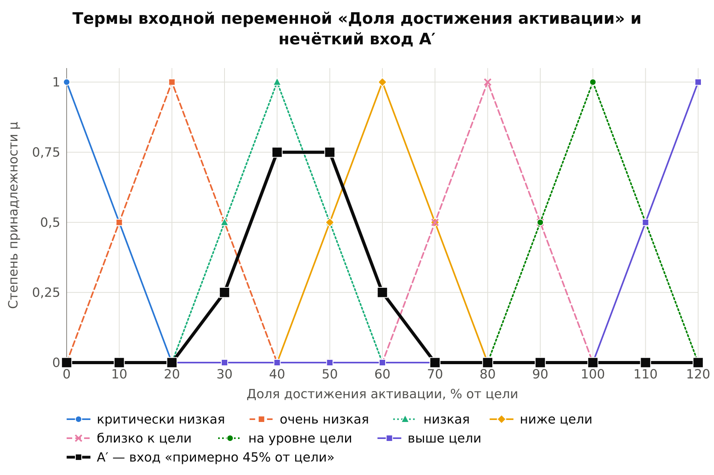{width=16.5cm}

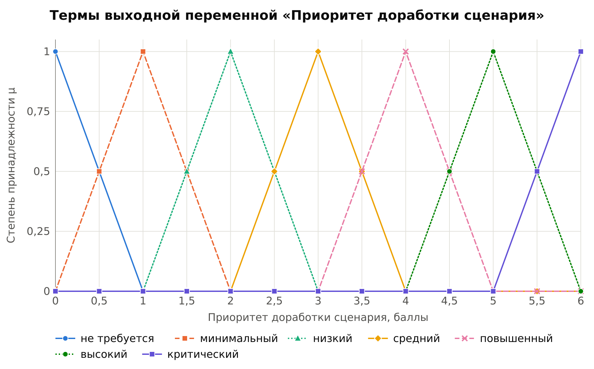{width=16.5cm}

Table: Таблица 3 — Термы входных переменных системы с тремя входами

| Переменная | Низкая (низкое) | Средняя (среднее) | Высокая (высокое) |
|-------------------------------|-------------|-------------|----------------|
| x1 доля_достижения_активации_3 | trap [0; 0; 40; 70] | tri [40; 70; 100] | trap [70; 100; 120; 120] |
| x2 доля_выбывших_по_неактивности | trap [0; 0; 20; 40] | tri [20; 45; 70] | trap [50; 70; 100; 100] |
| x3 удержание_после_активации | trap [0; 0; 20; 40] | tri [20; 45; 70] | trap [50; 70; 100; 100] |

Для переменных x2 и x3 выбран шаг сетки 5, чтобы вершина терма «средняя» (45%) попала в узел сетки (рисунок 3).

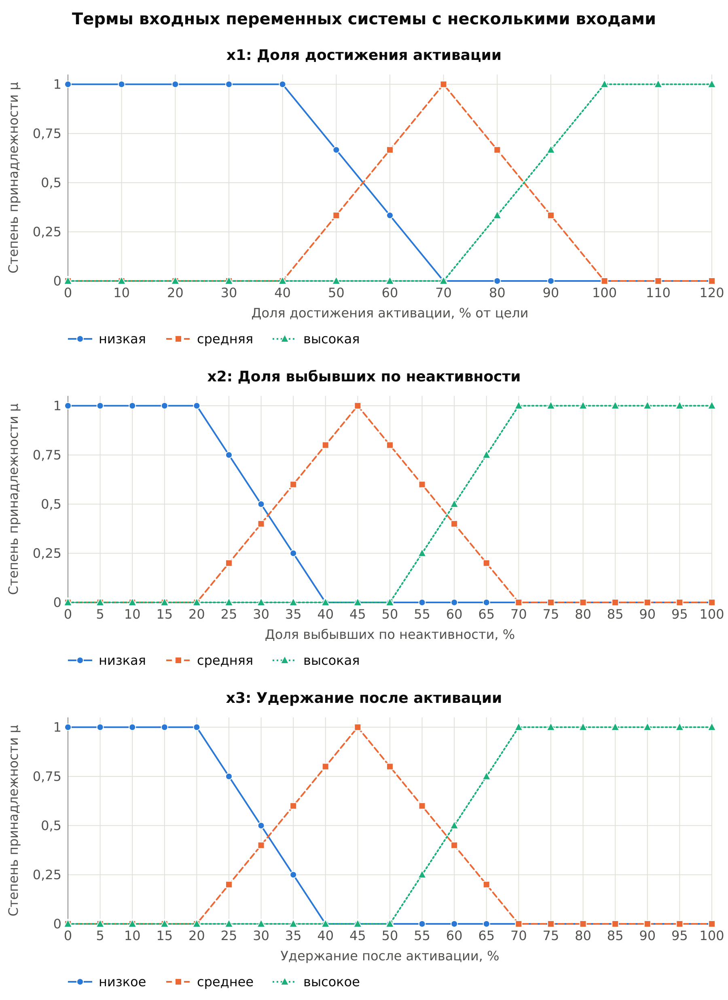{width=16.5cm}

## 2.3. Базы правил

Система с одним входом содержит 7 правил: чем ниже доля достижения активации, тем выше приоритет доработки сценария (таблица 4).

Table: Таблица 4 — База правил системы с одним входом

| № | ЕСЛИ доля_достижения_активации | ТО приоритет_доработки |
|---|------------------------------------------|-----------------------------|
| R1 | критически_низкая | критический |
| R2 | очень_низкая | высокий |
| R3 | низкая | повышенный |
| R4 | ниже_цели | средний |
| R5 | близко_к_цели | низкий |
| R6 | на_уровне_цели | минимальный |
| R7 | выше_цели | не_требуется |

Система с тремя входами содержит 9 правил. Кроме доли достижения активации учитываются доля пользователей, выбывших по неактивности, и удержание после активации — показатели, которые в базе ЛР 2 уже были объектами (таблица 5).

Table: Таблица 5 — База правил системы с тремя входами

| № | x1 активация | x2 выбывшие | x3 удержание | ТО приоритет_доработки |
|---|---------------|--------------|---------------|-------------------------|
| R1 | низкая | высокая | низкое | критический |
| R2 | низкая | высокая | высокое | высокий |
| R3 | низкая | низкая | низкое | высокий |
| R4 | низкая | низкая | высокое | повышенный |
| R5 | средняя | средняя | среднее | средний |
| R6 | высокая | средняя | низкое | средний |
| R7 | средняя | низкая | высокое | низкий |
| R8 | высокая | высокая | среднее | низкий |
| R9 | высокая | низкая | высокое | не_требуется |

## 2.4. Входные данные

При чётком входе все три механизма вывода дают одинаковый результат при любой импликации: синглтон сводит max-min композицию к значению функции принадлежности в точке входа. Поэтому для системы с одним входом вход задан нечётким множеством «примерно 45% от цели» = tri [25; 45; 65], на сетке A′ = 30/0,25 + 40/0,75 + 50/0,75 + 60/0,25 (рисунок 1). Для системы с тремя входами взяты чёткие значения: доля достижения активации 50% от цели, доля выбывших по неактивности 60%, удержание после активации 30%.

# 3. Архитектура и программная реализация

## 3.1. Программный модуль

Программа написана на языке C++17, сборка — CMake, чтение базы знаний — библиотека nlohmann/json (FetchContent), интерфейс — CLI. Из лабораторных работ № 1, 2 перенесены структура проекта, сборка, заголовки ReadChoice.hpp и Colors.hpp и схема меню. Механизм вывода ЛР 1, 2 не переносился: там факт либо истинен, либо ложен, а здесь вывод численный — степени принадлежности, матрицы и композиция.

Ссылка на репозиторий github: https://github.com/whocares26/ais_lab3.

Table: Таблица 6 — Модули программы

| Модуль | Назначение |
|-------------------------------------|-------------------------------------|
| db/Term.hpp | универсум, терм, вычисление μ по параметрам (tri, trap, points) и значений на сетке |
| db/LinguisticVariable.hpp, FuzzyRule.hpp, Scenario.hpp | лингвистическая переменная, правило «ЕСЛИ … ТО …», сценарий входов |
| db/KnowledgeBase | загрузка файла и проверка ссылок на переменные и термы |
| engine/FuzzyMath | импликации, агрегации, матрица правила, max-min композиция, центр тяжести |
| engine/Inference | алгоритмы 1–3, вывод для нескольких входов, протокол |
| engine/SvgPlot | построение графиков в формате SVG без сторонних библиотек |
| engine/Report | графики и таблицы для записки |
| engine/SelfTest | проверка по контрольным примерам лекции 4 |

## 3.2. Формат файла базы знаний

База знаний хранится в файле data/funnel.json. Он содержит лингвистические переменные, имя входа системы с одним входом, список входов системы с несколькими входами, имя выхода, две базы правил и именованные сценарии входов. Термы записаны массивом, а не объектом JSON: библиотека упорядочивает ключи объекта по алфавиту, а порядок термов важен для протокола и графиков. Ниже приведён фрагмент файла.

```
"доля_достижения_активации": {
    "title": "Доля достижения активации", "unit": "% от цели",
    "universe": { "min": 0, "max": 120, "step": 10 },
    "terms": [
        { "name": "критически_низкая", "type": "tri", "params": [-20, 0, 20] },
        { "name": "очень_низкая",      "type": "tri", "params": [0, 20, 40] },
        ...
    ]
},
...
"single_input_rules": [
    { "id": 3, "if": [ { "var": "доля_достижения_активации", "term": "низкая" } ],
               "then": { "var": "приоритет_доработки", "term": "повышенный" } },
...
"scenarios": [
    { "name": "примерно_45%_от_цели", "system": "single",
      "inputs": [ { "var": "доля_достижения_активации", "kind": "tri", "params": [25, 45, 65] } ] },
```

Для примера из лекции (файл data/lecture_example.json) универсум задаётся списком точек {800, 830, 860, 900}, а термы — значениями в узлах (тип points).

## 3.3. Импликации и операторы агрегации

Матрица правила «ЕСЛИ x есть A, ТО y есть B» вычисляется как R(x, y) = I(A(x), B(y)). Реализовано пять импликаций (таблица 7) и четыре оператора агрегации: max, вероятностная сумма a + b − ab, ограниченная сумма min(1, a + b) и min.

Table: Таблица 7 — Реализованные импликации

| Импликация | Формула I(a, b) | Тип | Агрегация по умолчанию |
|------------|-----------------------|--------------|------------------------|
| Мамдани | min(a, b) | конъюнктивная | max |
| Ларсен | a · b | конъюнктивная | max |
| Лукасевич | min(1, 1 − a + b) | логическая | min |
| Гёдель | 1, если a ≤ b, иначе b | логическая | min |
| Клини–Дайнс | max(1 − a, b) | логическая | min |

Конъюнктивное правило читается как «A и B вместе», поэтому выходы таких правил объединяются через max. Логическая импликация при A(x) = 0 даёт 1: правило, которое вход не задевает, ничего не запрещает, и выходы таких правил объединяются через «и», то есть min. При смене импликации программа предлагает агрегацию по умолчанию, но пользователь может выбрать любую из четырёх. Агрегация начинается с нейтрального элемента оператора (0 для max и сумм, 1 для min).

## 3.4. Механизмы вывода

Композиция max-min вычисляется как B′(y) = max по x от min(A′(x), R(x, y)). Для системы с одним входом реализованы три механизма:

```
алгоритм 1:  R_i = A_i → B_i;  B′_i = A′∘R_i;  B′ = Agg(B′_1, …, B′_n)
алгоритм 2:  R_i = A_i → B_i;  R = Agg(R_1, …, R_n) поэлементно;  B′ = A′∘R
алгоритм 3:  α_i = max_x min(A′(x), A_i(x));  B′_i(y) = I(α_i, B_i(y));  B′ = Agg(B′_i)
```

Для системы с несколькими входами применяется алгоритм 3, уровень истинности предпосылки — α_i = min_j max_x min(A′_j(x), A_ij(x)). Для чёткого входа x₀ используется синглтон: α_i = min_j A_ij(x_j0), значения функций принадлежности вычисляются по параметрам терма. В алгоритмах 1, 2 синглтон определён только на сетке, поэтому чёткий вход вне узла заменяется ближайшим узлом, о чём в протоколе выводится предупреждение.

Дефаззификация выполняется методом центра тяжести: y* = Σ y·B′(y) / Σ B′(y). Если B′ пустое (все степени равны нулю), y* не определён, и программа сообщает об этом без деления на ноль.

## 3.5. Меню и протокол вывода

Пункты меню: загрузка базы знаний, просмотр переменных и правил, выбор импликации, агрегации и механизма, вывод для одного входа, вывод для нескольких входов, сравнение импликаций, формирование отчёта (графики и таблицы) и самопроверка. Вход задаётся чётким числом, термом, термом с модификатором («очень A» = A², «более-менее A» = √A), значениями по точкам или готовым сценарием из файла.

Протокол вывода содержит уровни истинности всех правил, матрицы R_i (для алгоритмов 1, 2), выходы правил B′_i (для алгоритмов 1, 3) или агрегированную матрицу R (для алгоритма 2), итоговое множество B′ и y*. Матрицы печатаются только для правил с α_i > 0, о чём в протоколе есть пометка. Выходы правил не печатаются, если они тождественно равны нейтральному элементу агрегации и на итог не влияют; список таких правил выводится. Для логических импликаций правило с α_i = 0 в алгоритме 1 даёт не ноль, а постоянный уровень, поэтому такие правила печатаются.

После y* программа выводит словесный итог — терм выхода с наибольшей степенью принадлежности в точке y* и соседний терм, например «повышенный (μ = 0,81), соседний — средний (μ = 0,19)». Если y* лежит на границе двух термов и их степени равны, выводятся оба. В пункте «Вывод для одного входа» после протокола печатается сводка: итоговые B′, y* и ближайший терм для всех трёх механизмов при текущей импликации и агрегации.

Графики формируются самой программой (модуль SvgPlot) в формате SVG и переводятся в PNG утилитой rsvg-convert. У каждой импликации на всех графиках постоянный цвет, тип линии и маркер, поэтому графики различимы и при чёрно-белой печати.

# 4. Результаты

## 4.1. Система с одним входом

Вход «примерно 45% от цели» задевает три правила: α₂ = 0,25 (очень_низкая), α₃ = 0,75 (низкая), α₄ = 0,5 (ниже_цели), у остальных правил α_i = 0. Ниже подробно разобран вывод по алгоритму 1 с импликацией Мамдани и агрегацией max.

**Шаг 1. Матрицы правил.** Для импликации Мамдани строка матрицы, соответствующая x, — это min(A_i(x), B_i). Ненулевые строки матрицы R3 = низкая → повышенный приведены в таблице 8, остальные строки нулевые.

Table: Таблица 8 — Ненулевые строки матрицы R3 (Мамдани)

| x \\ y | 3 | 3,5 | 4 | 4,5 | 5 |
|-------------------------------------------------------|---|----|----|----|---|
| 30 (A₃ = 0,5) | 0 | 0,5 | 0,5 | 0,5 | 0 |
| 40 (A₃ = 1) | 0 | 0,5 | 1 | 0,5 | 0 |
| 50 (A₃ = 0,5) | 0 | 0,5 | 0,5 | 0,5 | 0 |

**Шаг 2. Выходы правил.** B′_i = A′∘R_i. Например, для R3 при y = 4: max(min(0,25; 0), min(0,75; 0,5), min(0,75; 1), min(0,75; 0,5), min(0,25; 0)) = 0,75. Аналогично получено:

- B′2 = 4,5/0,25 + 5/0,25 + 5,5/0,25;
- B′3 = 3,5/0,5 + 4/0,75 + 4,5/0,5;
- B′4 = 2,5/0,5 + 3/0,5 + 3,5/0,5.

Выходы R1, R5, R6, R7 тождественно равны нулю.

**Шаг 3. Агрегация.** B′ = max(B′_i) = 2,5/0,5 + 3/0,5 + 3,5/0,5 + 4/0,75 + 4,5/0,5 + 5/0,25 + 5,5/0,25.

**Шаг 4. Дефаззификация.** Σ B′(y) = 3,25; Σ y·B′(y) = 12,375; y* = 12,375 / 3,25 = 3,808 балла. В этой точке наибольшую степень имеет терм «повышенный» (μ = 0,81, соседний терм «средний» — 0,19), поэтому заключение системы: приоритет доработки сценария повышенный. Протокол программы для этого варианта и сводка по трём механизмам приведены на рисунке 4, выходы правил и B′ — на рисунке 5.

```
=== Вывод: один вход ===
Импликация: Мамдани (конъюнктивная), агрегация: max, композиция: max-min
Механизм: алгоритм 1 (первоначальное вычисление выходов правил)
Вход A′ (примерно 45% от цели): 30/0,25 + 40/0,75 + 50/0,75 + 60/0,25
УРОВНИ ИСТИННОСТИ ПРЕДПОСЫЛОК
α1 = 0     R1: критически_низкая → критический
α2 = 0,25  R2: очень_низкая → высокий
α3 = 0,75  R3: низкая → повышенный
α4 = 0,5   R4: ниже_цели → средний
α5 = 0     R5: близко_к_цели → низкий
α6 = 0     R6: на_уровне_цели → минимальный
α7 = 0     R7: выше_цели → не_требуется
МАТРИЦЫ ПРАВИЛ R_i = A_i → B_i
R2 (очень_низкая → высокий):
...
R3 (низкая → повышенный):
x \ y   0     0,5   1     1,5   2     2,5   3     3,5   4     4,5   5     5,5   6
...
30      0     0     0     0     0     0     0     0,5   0,5   0,5   0     0     0
40      0     0     0     0     0     0     0     0,5   1     0,5   0     0     0
50      0     0     0     0     0     0     0     0,5   0,5   0,5   0     0     0
...
R4 (ниже_цели → средний):
...
(матрицы R1, R5, R6, R7 не показаны: вход их не задевает, α_i = 0;
 в агрегации они всё равно участвуют)
ВЫХОДЫ ПРАВИЛ B′_i
y       0      0,5    1      1,5    2      2,5    3      3,5    4      4,5    5      5,5    6
B′2     0      0      0      0      0      0      0      0      0      0,25   0,25   0,25   0
B′3     0      0      0      0      0      0      0      0,5    0,75   0,5    0      0      0
B′4     0      0      0      0      0      0,5    0,5    0,5    0      0      0      0      0
(не показаны R1, R5, R6, R7: их B′_i ≡ 0 —
 нейтральный элемент агрегации «max», на итог не влияют)
ИТОГОВЫЙ ВЫХОД
B′ = 2,5/0,5 + 3/0,5 + 3,5/0,5 + 4/0,75 + 4,5/0,5 + 5/0,25 + 5,5/0,25
y* = 3,808 (центр тяжести, баллы)
Ближайший терм: повышенный (μ = 0,81), соседний — средний (μ = 0,19)
ЗАКЛЮЧЕНИЕ: приоритет_доработки — повышенный
СВОДКА ПО МЕХАНИЗМАМ (Мамдани, max)
y      0     0,5   1     1,5   2     2,5   3     3,5   4     4,5   5     5,5   6     y*   терм
Алг. 1 0     0     0     0     0     0,5   0,5   0,5   0,75  0,5   0,25  0,25  0     3,81 повышенный
Алг. 2 0     0     0     0     0     0,5   0,5   0,5   0,75  0,5   0,25  0,25  0     3,81 повышенный
Алг. 3 0     0     0     0     0     0,5   0,5   0,5   0,75  0,5   0,25  0,25  0     3,81 повышенный
```

::: {custom-style="Image Caption"}
Рисунок 4 — Протокол вывода (Мамдани, алгоритм 1) и сводка по механизмам (фрагмент)
:::

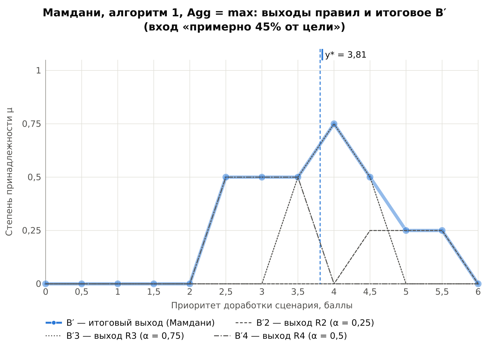{width=16.5cm}

Результаты остальных вариантов приведены в таблице 9. Для каждой импликации использована агрегация по умолчанию.

Table: Таблица 9 — Выход y* системы с одним входом, баллы

| Импликация | Agg | Алгоритм 1 | Алгоритм 2 | Алгоритм 3 |
|------------|----|------------|------------|---------------------------------|
| Мамдани | max | 3,81 | 3,81 | 3,81 |
| Ларсен | max | 3,92 | 3,92 | 3,83 |
| Лукасевич | min | 3,10 | 3,05 | 3,21 |
| Гёдель | min | 3,32 | 3,70 | не определён (B′ пустое) |
| Клини–Дайнс | min | 3,04 | 3,04 | 3,19 |

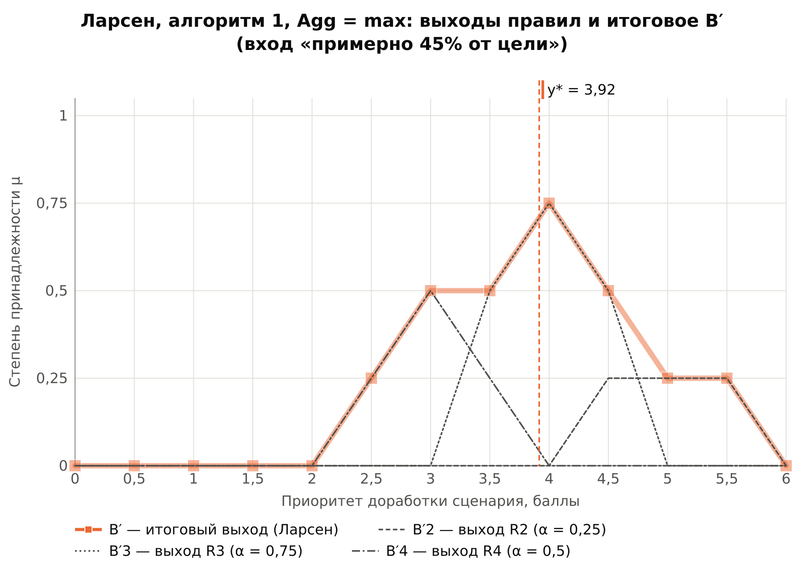{width=16.5cm}

Итоговые множества B′ всех вариантов приведены в таблице 10.

Table: Таблица 10 — Итоговые множества B′ (фрагмент: y от 2 до 6 баллов)

| Вариант | 2 | 2,5 | 3 | 3,5 | 4 | 4,5 | 5 | 5,5 | 6 |
|-------------------|-----|-----|-----|------|-----|------|-----|------|-----|
| Мамдани, алг. 1, 2, 3 | 0 | 0,5 | 0,5 | 0,5 | 0,75 | 0,5 | 0,25 | 0,25 | 0 |
| Ларсен, алг. 1, 2 | 0 | 0,25 | 0,5 | 0,5 | 0,75 | 0,5 | 0,25 | 0,25 | 0 |
| Ларсен, алг. 3 | 0 | 0,25 | 0,5 | 0,375 | 0,75 | 0,375 | 0,25 | 0,125 | 0 |
| Лукасевич, алг. 1 | 0,5 | 0,5 | 0,5 | 0,75 | 0,75 | 0,75 | 0,5 | 0,5 | 0,5 |
| Лукасевич, алг. 2 | 0,5 | 0,5 | 0,5 | 0,75 | 0,75 | 0,5 | 0,5 | 0,5 | 0,5 |
| Лукасевич, алг. 3 | 0,25 | 0,25 | 0,25 | 0,75 | 0,5 | 0,5 | 0,25 | 0,25 | 0,25 |
| Гёдель, алг. 1 | 0,25 | 0,25 | 0,25 | 0,75 | 0,75 | 0,75 | 0,25 | 0,25 | 0,25 |
| Гёдель, алг. 2 | 0 | 0,25 | 0,25 | 0,75 | 0,75 | 0,5 | 0 | 0 | 0 |
| Гёдель, алг. 3 | 0 | 0 | 0 | 0 | 0 | 0 | 0 | 0 | 0 |
| Клини–Дайнс, алг. 1, 2 | 0,5 | 0,5 | 0,5 | 0,5 | 0,75 | 0,5 | 0,5 | 0,5 | 0,5 |
| Клини–Дайнс, алг. 3 | 0,25 | 0,25 | 0,25 | 0,5 | 0,5 | 0,5 | 0,25 | 0,25 | 0,25 |

Для логических импликаций значения при y от 0 до 2 совпадают со значением при y = 2, для конъюнктивных они равны нулю.

## 4.2. Система с тремя входами

Для чётких входов x1 = 50, x2 = 60, x3 = 30 уровни истинности вычисляются по формуле α_i = min_j A_ij(x_j0). Степени соответствия входов термам правил и уровни истинности приведены в таблице 11: сработали правила R1 (α₁ = 0,5) и R5 (α₅ = 0,333).

Table: Таблица 11 — Степени соответствия и уровни истинности

| Правило | x1 = 50 | x2 = 60 | x3 = 30 | ТО | α_i |
|--------|----------------|--------------|--------------|-------------|------|
| R1 | низкая (0,667) | высокая (0,5) | низкое (0,5) | критический | 0,5 |
| R2 | низкая (0,667) | высокая (0,5) | высокое (0) | высокий | 0 |
| R3 | низкая (0,667) | низкая (0) | низкое (0,5) | высокий | 0 |
| R4 | низкая (0,667) | низкая (0) | высокое (0) | повышенный | 0 |
| R5 | средняя (0,333) | средняя (0,4) | среднее (0,4) | средний | 0,333 |
| R6 | высокая (0) | средняя (0,4) | низкое (0,5) | средний | 0 |
| R7 | средняя (0,333) | низкая (0) | высокое (0) | низкий | 0 |
| R8 | высокая (0) | высокая (0,5) | среднее (0,4) | низкий | 0 |
| R9 | высокая (0) | низкая (0) | высокое (0) | не_требуется | 0 |

При импликации Мамдани выход правила R1 — терм «критический», срезанный на уровне 0,5; выход R5 — терм «средний», срезанный на уровне 0,333. Их объединение B′ = 2,5/0,333 + 3/0,333 + 3,5/0,333 + 5,5/0,5 + 6/0,5, центр тяжести y* = 4,375 балла (рисунки 7, 8). В этой точке наибольшую степень имеет терм «повышенный» (μ = 0,62), соседний — «высокий» (μ = 0,38). Содержательно: при активации на половине цели, большой доле выбывших и слабом удержании приоритет доработки сценария повышенный, ближе к высокому — около 4,4 балла из 6.

```
=== Вывод: несколько входов ===
Импликация: Мамдани (конъюнктивная), агрегация: max
Механизм: алгоритм 3 (уровни истинности предпосылок)
x1 доля_достижения_активации_3 = 50 (чёткий)
x2 доля_выбывших_по_неактивности = 60 (чёткий)
x3 удержание_после_активации = 30 (чёткий)
СТЕПЕНИ СООТВЕТСТВИЯ ВХОДОВ И УРОВНИ ИСТИННОСТИ
R1: низкая(x1) = 0,667, высокая(x2) = 0,5, низкое(x3) = 0,5              α1 = 0,5
...
R5: средняя(x1) = 0,333, средняя(x2) = 0,4, среднее(x3) = 0,4            α5 = 0,333
...
ВЫХОДЫ ПРАВИЛ B′_i
y       0      0,5    1      1,5    2      2,5    3      3,5    4      4,5    5      5,5    6
B′1     0      0      0      0      0      0      0      0      0      0      0      0,5    0,5
B′5     0      0      0      0      0      0,333  0,333  0,333  0      0      0      0      0
(не показаны R2, R3, R4, R6, R7, R8, R9: их B′_i ≡ 0 —
 нейтральный элемент агрегации «max», на итог не влияют)
ИТОГОВЫЙ ВЫХОД
B′ = 2,5/0,333 + 3/0,333 + 3,5/0,333 + 5,5/0,5 + 6/0,5
y* = 4,375 (центр тяжести, баллы)
Ближайший терм: повышенный (μ = 0,62), соседний — высокий (μ = 0,38)
ЗАКЛЮЧЕНИЕ: приоритет_доработки — повышенный
```

::: {custom-style="Image Caption"}
Рисунок 7 — Протокол вывода системы с тремя входами (фрагмент)
:::

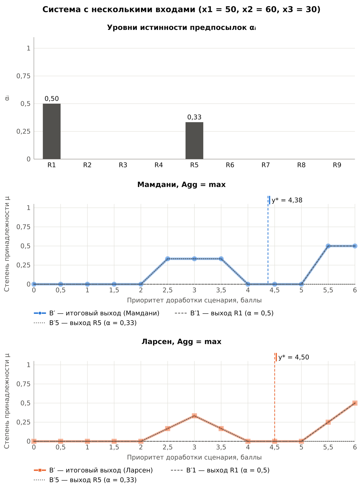{width=16.5cm}

# 5. Сравнение импликаций

## 5.1. Система с одним входом

Итоговые множества B′ всех импликаций по трём механизмам показаны на рисунках 9 (конъюнктивные импликации) и 10 (логические импликации), значения y* — на рисунке 11 и в таблице 9.

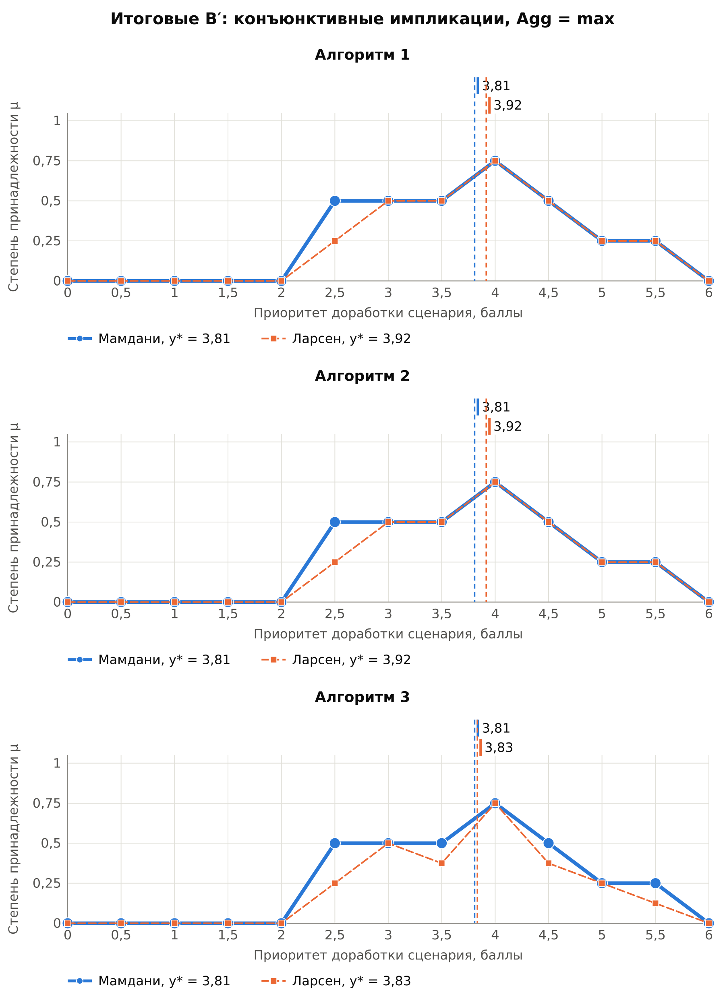{width=16.5cm}

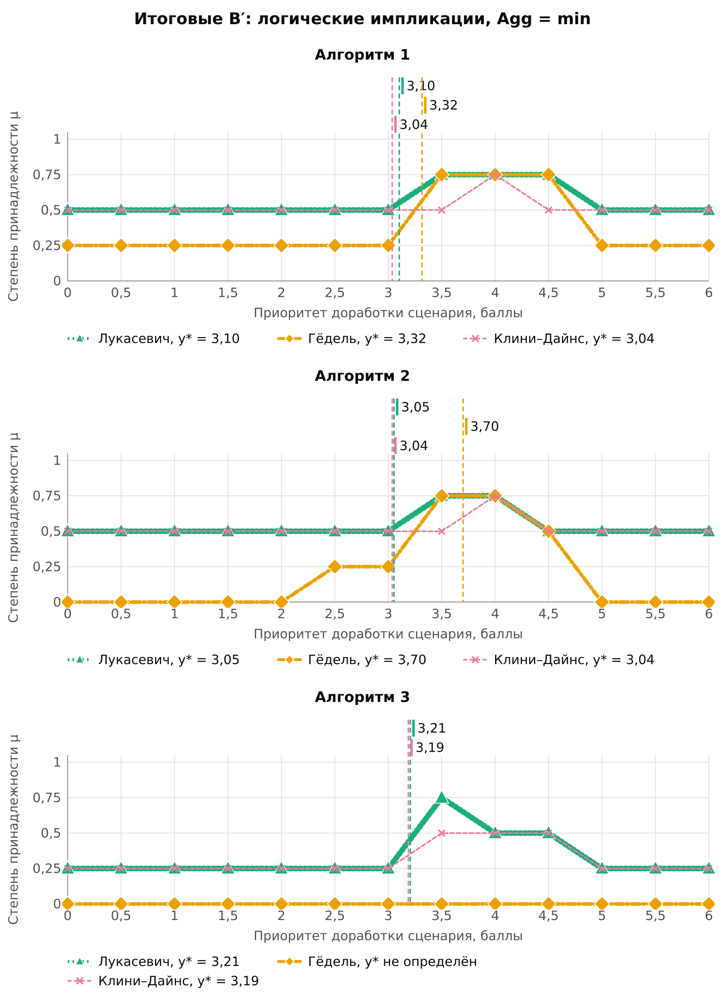{width=16.5cm}

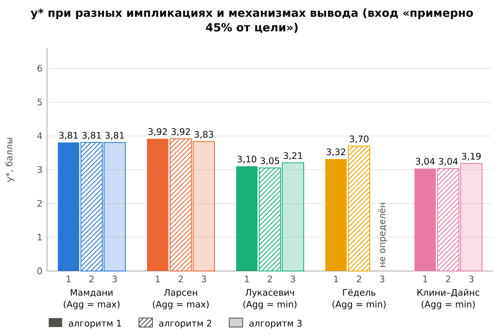{width=16.5cm}

**Мамдани.** Все три механизма дали одно и то же B′ и y* = 3,81, что подтверждает Предложения 1 и 2 лекции 4: при max-min композиции и Agg = max алгоритмы 1 и 2 совпадают, а у импликации Мамдани max_x min(A′(x), min(A_i(x), b)) = min(α_i, b), поэтому совпадает и алгоритм 3. Совпадение получено и на контрольном примере лекции (раздел 5.5).

**Ларсен.** Алгоритмы 1 и 2 совпали (y* = 3,92): при Agg = max они совпадают при любой импликации, поскольку min и max можно переставлять. Алгоритм 3 дал другой результат (y* = 3,83): композиция ищет лучшее x отдельно для каждого y, а уровень истинности сначала сжимает совпадение входа с правилом в одно число. Например, при y = 3,5 правило R3 по композиции даёт 0,5, а по уровню истинности — α₃·B₃(3,5) = 0,75·0,5 = 0,375 (таблица 10). Форма B′ у Ларсена отличается от Мамдани: выход правила не срезается, а сжимается пропорционально α_i.

**Логические импликации.** Лукасевич, Гёдель и Клини–Дайнс дают «подложку» — ненулевой уровень B′ по всей шкале (0,5 в алгоритмах 1, 2 и 0,25 в алгоритме 3 у Лукасевича и Клини–Дайнса): правило со слабым α почти ничего не запрещает, и эта неопределённость распределяется по всей шкале. Центр тяжести тянется к середине шкалы (3 балла), поэтому y* логических импликаций (3,04–3,32, кроме Гёделя в алгоритме 2) меньше, чем у конъюнктивных (3,81–3,92). При Agg = min расходятся все три механизма, например у Лукасевича 3,10, 3,05 и 3,21.

**Гёдель.** На узких термах импликация Гёделя вырождается: в алгоритме 3 выход сработавшего правила B′_i(y) = I(α_i, B_i(y)) вне носителя терма B_i равен нулю, а носители термов «высокий» (R2, от 4 до 6 баллов) и «средний» (R4, от 2 до 4 баллов) не пересекаются. Поэтому минимум выходов правил равен нулю во всех точках — B′ пустое, y* не определён. Кроме того, Гёдель разрывен в точке a = b: на сетке, где степени входа и выхода точно совпадают (0,5 и 0,5), сколь угодно малая погрешность в вычислении степеней меняет I(a, b) с 1 на b и заметно сдвигает результат алгоритмов 1, 2 (пример — в разделе 6.3).

**Выбор агрегации.** Таблица 12 показывает, почему для конъюнктивных и логических импликаций нужны разные операторы. Конъюнктивная импликация с Agg = min даёт пустое B′: выходы несработавших правил равны нулю и обнуляют итог. Логическая импликация с Agg = max даёт B′ ≡ 1 и y* = 3,00 при любом входе: несработавшие правила дают единицы. При Agg, отличном от max, алгоритмы 1 и 2 у Мамдани расходятся (3,81 и 3,79 при вероятностной сумме), как и в примере лекции.

Table: Таблица 12 — y* при разных операторах агрегации (фрагмент)

| Импликация | Agg | Алгоритм 1 | Алгоритм 2 | Алгоритм 3 |
|-----------|-------------------------|------------|------------|------------|
| Мамдани | max | 3,81 | 3,81 | 3,81 |
| Мамдани | вероятностная сумма | 3,81 | 3,79 | 3,81 |
| Мамдани | min | не опр. | не опр. | не опр. |
| Ларсен | ограниченная сумма | 3,93 | 3,92 | 3,83 |
| Лукасевич | max | 3,00 | 3,00 | 3,00 |
| Лукасевич | min | 3,10 | 3,05 | 3,21 |

**Характеристика системы.** На рисунке 12 показана зависимость y*(x) при чётком входе. Конъюнктивные импликации дают почти линейную монотонную характеристику: приоритет снижается от 5,83 до 0,17 балла по мере роста доли достижения активации. Крайние значения не равны 6 и 0, так как крайние термы выхода обрезаны универсумом и их центр тяжести смещён внутрь. У логических импликаций между вершинами термов входа y* проваливается к середине шкалы (у Клини–Дайнса до 3,00 при x = 10, 30, 50, …), а у Гёделя характеристика ступенчатая. Для системы управления приоритетом конъюнктивные импликации дают более осмысленный результат.

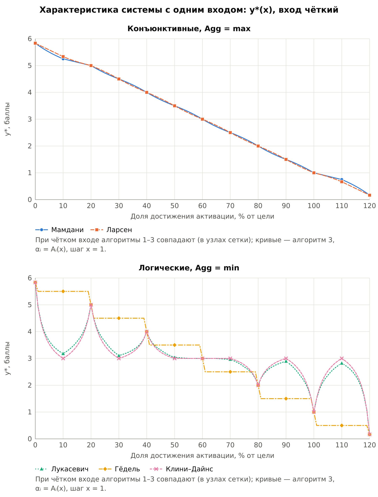{width=16.5cm}

## 5.2. Система с тремя входами

Table: Таблица 13 — Выход y* системы с тремя входами (x1 = 50, x2 = 60, x3 = 30), алгоритм 3

| Импликация | Agg | y*, баллы | Ближайший терм |
|------------|----|----------------------|-----------------------------------|
| Мамдани | max | 4,375 | повышенный (0,62), соседний — высокий (0,38) |
| Ларсен | max | 4,500 | повышенный / высокий (0,5, на границе термов) |
| Лукасевич | min | 3,134 | средний (0,87) |
| Гёдель | min | не определён (B′ пустое) | — |
| Клини–Дайнс | min | 3,075 | средний (0,93) |

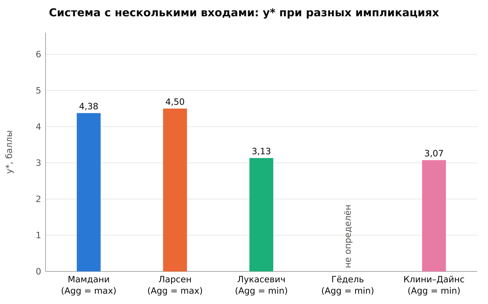{width=16.5cm}

Как и в системе с одним входом, конъюнктивные импликации дают близкие значения (4,375 и 4,500): у Ларсена выход правила R5 сжимается сильнее, чем у R1, поэтому центр тяжести смещается вправо. Логические импликации из-за подложки дают значения около середины шкалы (3,13 и 3,08), у Гёделя B′ пустое. На рисунке 14 показана зависимость y*(x1) при x2 = 60, x3 = 30. Конъюнктивные импликации монотонно снижают приоритет с 5,8 до 2,5 балла при росте доли достижения активации; логические почти не реагируют на x1, а у Гёделя при x1 от 40 до 70 B′ пустое.

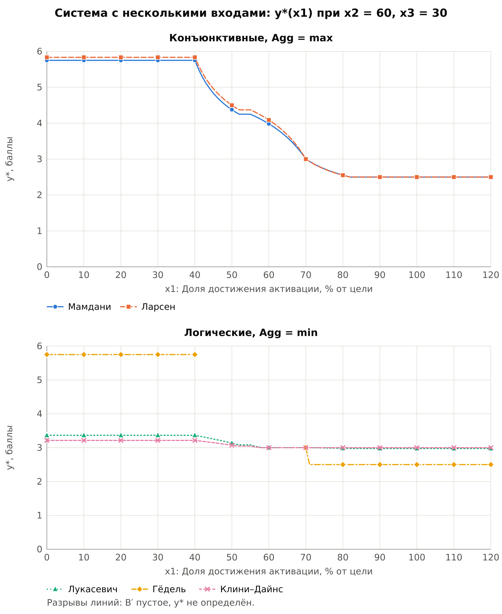{width=16.5cm}

## 5.3. Словесный итог

Число y* удобно переводить обратно в термы выходной переменной. Таблица 14 показывает, что выбор импликации меняет не только число, но и словесное заключение: конъюнктивные импликации относят результат к терму «повышенный», логические — к терму «средний». Причина — подложка логических импликаций, которая смещает центр тяжести к середине шкалы. Единственное расхождение внутри одной импликации — Гёдель: алгоритм 1 даёт «средний», алгоритм 2 — «повышенный», алгоритм 3 — пустое B′.

Table: Таблица 14 — Словесный итог: терм выхода с наибольшей степенью в точке y*

| Импликация | Алгоритм 1 | Алгоритм 2 | Алгоритм 3 | Три входа |
|------------|--------------|--------------|--------------|------------------|
| Мамдани | повышенный (0,81) | повышенный (0,81) | повышенный (0,81) | повышенный (0,62) |
| Ларсен | повышенный (0,92) | повышенный (0,92) | повышенный (0,83) | повышенный / высокий (0,5) |
| Лукасевич | средний (0,9) | средний (0,95) | средний (0,79) | средний (0,87) |
| Гёдель | средний (0,68) | повышенный (0,7) | не определён | не определён |
| Клини–Дайнс | средний (0,96) | средний (0,96) | средний (0,81) | средний (0,93) |

## 5.4. Выводы по сравнению

1. При импликации Мамдани и Agg = max три механизма вывода дают одинаковый результат, что подтверждает Предложения 1 и 2 лекции 4.
2. При Agg = max алгоритмы 1 и 2 совпадают при любой импликации; алгоритм 3 у Ларсена даёт другое B′ и y*.
3. Логические импликации требуют агрегации min и дают подложку, которая смещает центр тяжести к середине шкалы; при Agg = min все три механизма расходятся.
4. Импликация Гёделя на узких термах вырождается (пустое B′) и чувствительна к точному совпадению степеней.
5. Выбор импликации меняет словесное заключение: конъюнктивные импликации дают приоритет «повышенный», логические — «средний».
6. Для решаемой задачи предпочтительны конъюнктивные импликации: их характеристика монотонна и соответствует смыслу правил.

## 5.5. Проверка на контрольных примерах

Пункт меню «9. Самопроверка» сравнивает результаты программы с примерами лекции 4 и с рассчитанными значениями для воронки (рисунок 15). Все 36 проверок пройдены с допуском 0,01.

```
=== Самопроверка (допуск 0,01) ===
Проверка                                   Ожидалось                Получено                 Итог
Лекция: только R1, Мамдани, B′             (0,5; 0,8; 0,5)          (0,5; 0,8; 0,5)          ОК
Лекция: Мамдани, max, алг. 1, B′           (0,8; 0,8; 0,5)          (0,8; 0,8; 0,5)          ОК
Лекция: Мамдани, max, алг. 1, y*           342,86                   342,857                  ОК
...
Лекция: Ларсен, max, алг. 3, B′            (0,8; 0,8; 0,4)          (0,8; 0,8; 0,4)          ОК
Лекция: Мамдани, вер. сумма, алг. 1, B′    (0,9; 0,88; 0,55)        (0,9; 0,88; 0,55)        ОК
Лекция: Мамдани, вер. сумма, алг. 2, B′    (0,8; 0,88; 0,55)        (0,8; 0,88; 0,55)        ОК
Лекция, 2 входа: α                         (0,3; 0,3; 0,8)          (0,3; 0,3; 0,8)          ОК
...
Лекция, 2 входа: Мамдани, y*               350,00                   350,000                  ОК
Лекция, x1 = 860, x2 = 520: α              (0,3; 0,3; 0,8)          (0,3; 0,3; 0,8)          ОК
...
Воронка п. 2: Ларсен, max, алг. 3, y*      3,83                     3,833                    ОК
...
Воронка п. 2: Гёдель, min, алг. 1, y*      3,32                     3,316                    ОК
...
Воронка п. 2: Гёдель, min, алг. 3, y*      B′ пустое                B′ пустое                ОК
...
Воронка п. 3: Мамдани, max, y*             4,38                     4,375                    ОК
...
Пройдено 36 из 36
```

::: {custom-style="Image Caption"}
Рисунок 15 — Результат самопроверки (фрагмент)
:::

# 6. Отчёт об использовании систем искусственного интеллекта

Раздел составлен согласно политике использования студентами искусственного интеллекта. Использованный инструмент — Claude (Anthropic): в чате — для оценки кода ЛР 1, 2, выбора задачи, разбора лекций 3, 4 и подготовки задания; в среде Claude Code — для разработки программы. Код ЛР 3 (программа, базы знаний, модуль графиков, самопроверка), графики и черновик пояснительной записки сгенерированы Claude Code по промпту студента. Студент утверждал план, отвечал на вопросы, уточнял требования и проверял результат: контрольные значения, протоколы, графики и текст записки. Ход работы и решения зафиксированы в файле docs/ai_log.md репозитория.

## 6.1. Лог взаимодействия

Table: Таблица 15 — Лог взаимодействия с ИИ-инструментом

| № | Запрос | Полученный результат и принятое решение |
|---|--------------------|---------------------------------------------------|
| 1 | Оценить пригодность кода ЛР 1, 2 для ЛР 3 | Механизм вывода ЛР 1, 2 символьный (факт истинен или ложен) и не переносится. Переносятся сборка, ReadChoice.hpp, Colors.hpp, схема меню и предметная область. Принято |
| 2 | Предложить предметную задачу | Предложены автомасштабирование по нагрузке и приоритет доработки сценария активации. Выбрана воронка активации как продолжение ЛР 1, 2 |
| 3 | Выбрать язык: C++ или Python-пакеты | Готовые пакеты в основном реализуют только алгоритм 3; композиционные алгоритмы 1, 2 всё равно пишутся вручную. Выбран C++ |
| 4 | Разобрать лекции 3, 4 | Получен конспект; найдены опечатки (слайд 9 лекции 3; «давления от температуры»; A₂₃ вместо A₃₂). Выявлено, что при чётком входе механизмы совпадают, поэтому вход в п. 2 задан нечётким |
| 5 | Подготовить задание для Claude Code | Составлен промпт: план, формулы, параметры термов, контрольные значения, требования к графикам и записке |
| 6 | Изучить код ЛР 1, 2 и предложить план (Claude Code) | Описан стиль кода, предложены структура файлов, классы, формат JSON, меню и список графиков. План утверждён с уточнениями: проект в корне репозитория ais_lab3, все термы входа п. 2 — треугольные, агрегация с нейтрального элемента, пометка о скрытых правилах в протоколе |
| 7 | Реализовать программу по плану | Сгенерированы модули db и engine, базы funnel.json и lecture_example.json, модуль графиков SVG. Проект собран без ошибок и предупреждений |
| 8 | Самопроверка по контрольным значениям | 34 из 36 при первом прогоне: расхождение у Гёделя (алг. 1, 2). Контрольные значения, полученные от ИИ, содержали ошибку (раздел 6.3); формулы программы не менялись, эталон пересчитан точно; 36 из 36 |
| 9 | Построить и проверить графики | Сформированы 10 графиков; при просмотре PNG обнаружены обрезанный заголовок, наложение подписей y* и пояснений, перекрытие совпадающих линий. Добавлены перенос строк, короткие подписи y* с полными значениями в легенде, утолщение нижних линий. Результат проверен повторно |
| 10 | Подготовить черновик записки | Сформирован черновик по структуре записки ЛР 2; все числа взяты из вывода программы (plots/results.md) |
| 11 | Сравнить с программой одногруппника по присланному им снимку экрана и добавить недостающее | Сравнивался состав выводимой информации при выводе для одного входа: в программе одногруппника есть сводная таблица B′ и y* для трёх алгоритмов и словесный итог (ближайший терм выхода), в нашей программе их не было. Код одногруппника не использовался, были заимствованы только идеи двух функций. Добавлены сводка по трём механизмам (B′, y*, ближайший терм) после протокола вывода для одного входа и словесный итог после y* во всех видах вывода. При проверке обнаружено, что у Ларсена при y* = 4,5 степени двух термов равны; выбор между ними зависел от погрешности вычислений, теперь выводятся оба термина. Самопроверка — 36 из 36 |

## 6.2. Анализ альтернативных решений

Table: Таблица 16 — Анализ альтернативных решений

| Решение | Рассмотренные варианты | Выбор и обоснование |
|--------------|-----------------------------|-------------------------------|
| Язык и средства | Python-пакеты нечёткой логики; C++ с собственной реализацией | C++: пакеты в основном реализуют только вывод по уровням истинности, алгоритмы 1, 2 с матрицами пришлось бы писать вручную; сохраняется преемственность с ЛР 1, 2 |
| Хранение термов в JSON | объект «имя: терм»; nlohmann::ordered_json; массив термов | Массив: обычный json сортирует ключи по алфавиту и теряет порядок термов; ordered_json сохранил бы порядок, но потребовал бы другого типа во всём коде загрузки, и порядок зависел бы от неочевидной детали библиотеки |
| Задание термов | значения в узлах; параметры tri, trap | Оба способа: параметры короче и позволяют вычислять μ в любой точке, значения в узлах нужны для примера лекции |
| Начало агрегации | нулевой вектор; выход первого правила; нейтральный элемент | Нейтральный элемент: с нулевым вектором агрегация min обнулила бы результат, нейтральный элемент корректен для всех операторов |
| Чёткий вход в алгоритмах 1, 2 | ближайший узел сетки; запрет чёткого входа | Ближайший узел с предупреждением: синглтон определён только на сетке, а запрет сделал бы невозможным сравнение механизмов |
| Построение графиков | ручная подготовка; сторонняя библиотека; собственный модуль SVG | Собственный модуль: графики формирует программа, сторонние библиотеки не требуются |
| Совпадающие линии на графиках | наложение; смещение маркеров; разнесение по панелям и утолщение нижних линий | Разнесение по панелям (конъюнктивные и логические, по алгоритмам) и утолщение нижних линий: смещение исказило бы координаты |

## 6.3. Выявленные допущения и ограничения

Table: Таблица 17 — Выявленные допущения и ограничения

| Допущение | Проявление | Адаптация |
|----------------|---------------------------------|-------------------------|
| Параметры термов и правил | Параметры термов, базы правил и сценарии входов предложены ИИ-инструментом как черновик | Черновик принят студентом после проверки смысла правил и контрольных расчётов |
| Агрегация по умолчанию | Для конъюнктивных импликаций — max, для логических — min | Пользователь может выбрать любой оператор; последствия другого выбора показаны в таблице 12 |
| Контрольные значения для импликации Гёделя | Контрольные значения для Гёделя, полученные от ИИ (3,24 и 3,72 для алгоритмов 1, 2), содержали ошибку: в проверочном скрипте к знаменателю треугольной функции принадлежности было прибавлено 10⁻¹². Из-за этого степень 0,5 вычислялась как 0,4999999999998 на входе и 0,4999999999995 на выходе, и в точке разрыва Гёделя сравнение a ≤ b ложно давало «нет». Ошибку обнаружила самопроверка программы | Эталон пересчитан точно (дробями): 63/19 ≈ 3,316 для алгоритма 1, 37/10 = 3,700 для алгоритма 2, для алгоритма 3 B′ пустое. Формулы программы не менялись |
| Обрезанные крайние термы выхода | Крайние термы выхода («не_требуется», «критический») выходят за границы универсума, на сетке от них остаётся половина треугольника; центр тяжести такой половины смещён внутрь шкалы, поэтому крайние значения y* не равны 0 и 6 (например, 5,83 при x = 0) | Ограничение сохранено: это свойство метода центра тяжести на ограниченном универсуме; отмечено в разделе 5.1 |
| Шаг сетки переменных x2, x3 | При шаге 10 вершина терма «средняя/среднее» (45%) не попадала в узел сетки, и терм на сетке не достигал 1 | Шаг сетки x2, x3 уменьшен до 5 при тех же параметрах термов, вершина терма попадает в узел; результаты при чётких входах не изменились, так как степени принадлежности вычисляются по параметрам термов |
| Синглтон на сетке | В алгоритмах 1, 2 чёткий вход вне узла заменяется ближайшим узлом | В протоколе выводится предупреждение; характеристика y*(x) построена алгоритмом 3 |
| Словесный итог по ближайшему терму | y* относится к терму с наибольшей степенью в точке y*; точка на границе двух термов не принадлежит ни одному полностью | Выводятся ближайший и соседний термы со степенями, при равных степенях — оба термина |
| Относительный путь к файлу базы знаний | При запуске из другого каталога файл не обнаруживается | Путь можно передать аргументом; порядок запуска описан в README |

# Заключение

Разработана программа для обработки нечётких систем логического вывода с одной и несколькими входными переменными. База знаний (лингвистические переменные, термы, базы правил и сценарии входов) хранится в отдельном файле JSON. Реализованы пять импликаций, четыре оператора агрегации, max-min композиция, три механизма вывода и дефаззификация методом центра тяжести; программа выводит подробный протокол, сводку по трём механизмам и словесный итог, а также сама строит графики. Корректность проверена на примерах лекции 4: все 36 контрольных проверок пройдены.

На предметной области воронки активации построены система с одним входом из 7 правил и система с тремя входами из 9 правил. Для нечёткого входа «примерно 45% от цели» приоритет доработки составил 3,81 балла (Мамдани, все три механизма) и 3,92 / 3,83 (Ларсен), для входов (50, 60, 30) — 4,375 (Мамдани) и 4,5 (Ларсен); в словесной форме — приоритет доработки повышенный. Сравнение импликаций подтвердило совпадение механизмов у Мамдани, показало расхождение алгоритма 3 у Ларсена и смещение результата логических импликаций к середине шкалы (словесный итог меняется с «повышенный» на «средний»), а также вырождение импликации Гёделя на узких термах.
